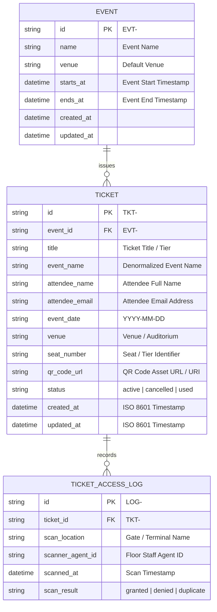
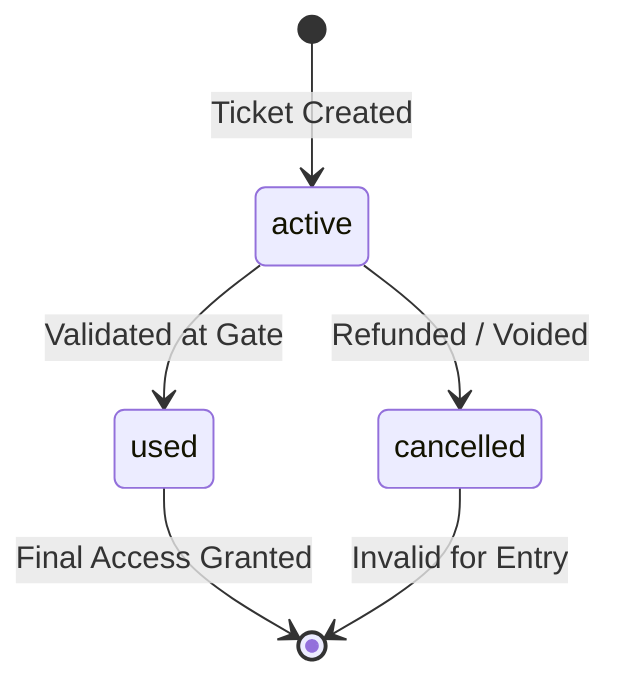

# Database Schema Architecture: Ticket QR Code Generator Worker

This document specifies the database design, entity specifications, constraints, indexing strategies, and relationships for the **Ticket QR Code Generator Worker** system.

---

## 1. Entity-Relationship Diagram (ERD)



---

## 2. Definitive Table Specification: `tickets`

| Column Name | SQL Data Type | Nullable | Default | Constraints & Validation | Description |
|---|---|---|---|---|---|
| `id` | `VARCHAR(32)` | **NO** | — | **PRIMARY KEY**, Format: `^TKT-\d+$` | Unique human-readable ticket ID |
| `event_id` | `VARCHAR(64)` | YES | `NULL` | Foreign key to `events.id` | Optional relational event reference |
| `title` | `VARCHAR(128)` | **NO** | — | `CHECK (LENGTH(TRIM(title)) > 0)` | Ticket tier / pass title (e.g. VIP Pass) |
| `event_name` | `VARCHAR(255)` | **NO** | — | `CHECK (LENGTH(TRIM(event_name)) > 0)` | Name of the event (denormalized for worker resilience) |
| `attendee_name` | `VARCHAR(255)` | **NO** | — | `CHECK (LENGTH(TRIM(attendee_name)) > 0)` | Full name of the badge holder |
| `attendee_email` | `VARCHAR(255)` | **NO** | — | Valid RFC 5322 email format | Contact email for ticket delivery |
| `event_date` | `CHAR(10)` | **NO** | — | `CHECK (event_date ~ '^\d{4}-\d{2}-\d{2}$')` | Event date in ISO 8601 date format |
| `venue` | `VARCHAR(255)` | **NO** | `'Main Hall'` | `CHECK (LENGTH(TRIM(venue)) > 0)` | Physical location or hall |
| `seat_number` | `VARCHAR(64)` | **NO** | `'GA'` | `CHECK (LENGTH(TRIM(seat_number)) > 0)` | Specific seat or General Admission indicator |
| `qr_code_url` | `TEXT` | YES | `NULL` | Valid URI format if populated | Generated QR Code CDN URL or data URI |
| `status` | `VARCHAR(16)` | **NO** | `'active'` | `CHECK (status IN ('active', 'cancelled', 'used'))` | Lifecycle access status |
| `created_at` | `TIMESTAMPTZ` | **NO** | `CURRENT_TIMESTAMP` | ISO 8601 UTC timestamp | Record creation timestamp |
| `updated_at` | `TIMESTAMPTZ` | **NO** | `CURRENT_TIMESTAMP` | ISO 8601 UTC timestamp | Last state modification timestamp |

---

## 3. Status Enumeration

The `status` field strictly enforces a finite state machine:



* **`active`**: Default state upon successful generation. Valid for entry scanning.
* **`used`**: Redeemed by floor staff at access control gate. Prevents duplicate entry.
* **`cancelled`**: Voided due to refund, re-issue, or security invalidation.

---

## 4. Indexing Strategy & Performance Recommendations

1. **Primary Lookup Index:**
   ```sql
   CREATE UNIQUE INDEX idx_tickets_pk ON tickets (id);
   ```
   * *Rationale:* High-throughput O(1) lookups during scanning operations at entrance gates.

2. **Email Lookup & Attendee History:**
   ```sql
   CREATE INDEX idx_tickets_attendee_email ON tickets (attendee_email);
   ```
   * *Rationale:* Enables attendees and support staff to query all tickets associated with an email address.

3. **Event Date & Status Filtering Index (Composite):**
   ```sql
   CREATE INDEX idx_tickets_event_date_status ON tickets (event_date, status);
   ```
   * *Rationale:* Optimizes day-of-event dashboard queries, checking active passes for today's date.

4. **Event ID Relational Index:**
   ```sql
   CREATE INDEX idx_tickets_event_id ON tickets (event_id) WHERE event_id IS NOT NULL;
   ```
   * *Rationale:* Speeds up event-level aggregation and attendee roster generation.

---

## 5. Security & Data Integrity Rules

1. **Input Sanitization at Application Boundary:**
   All text fields (`title`, `event_name`, `attendee_name`, `venue`, `seat_number`) are sanitized via `sanitizeInput()` before persistence to neutralize stored XSS (`<script>`, inline event handlers, `javascript:` schemes).
2. **Defensive Prototype Pollution Prevention:**
   State persistence explicitly isolates object prototypes using null-prototype stores or strict DTO transformations.
3. **Idempotent Identifiers:**
   Ticket IDs follow standard `TKT-<digits>` format (e.g., `TKT-001`), supporting deterministic regeneration without duplication.
